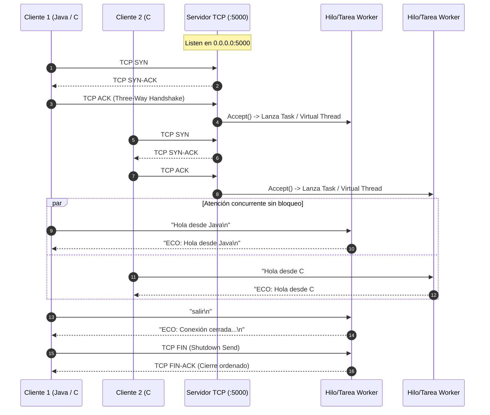

# Reporte Técnico: Práctica de Laboratorio — Sockets TCP/IP

---

**TECNOLÓGICO NACIONAL DE MÉXICO**  
**Tecnológico Campus Monclova**  

**Carrera:** Ingeniería en Informática / Licenciatura en Informática  
**Asignatura:** Programación en Ambiente Cliente/Servidor  

**Práctica de Laboratorio:**  
*Comunicación mediante Sockets TCP/IP, Concurrencia e Interoperabilidad (.NET 10 y Java)*

**Presenta:**  
Edwin Montemayor Medrano  
No. de Control: I23050348  

**Docente:**  
Ruben Miguel Riojas  

**Fecha:**  
3 de octubre del 2026

---

## 1. Objetivo de la Práctica

Diseñar, implementar y evaluar el intercambio de mensajes entre procesos remotos utilizando el protocolo de transporte TCP mediante la abstracción de **Sockets** en dos ecosistemas distintos (**C# sobre .NET 10** y **Java 21 LTS**), demostrando:

1. Comunicación básica bidireccional tipo Eco con cierre ordenado de sesión.
2. Atención concurrente de múltiples clientes simultáneos sin bloqueo del puerto de escucha.
3. Interoperabilidad heterogénea real entre un servidor en C# y un cliente en Java, y viceversa.
4. Manejo controlado de excepciones de red, puertos ocupados, tiempos de espera y desconexiones inesperadas.

---

## 2. Protocolo de Comunicación y Diagrama de Secuencia UML

### 2.1 Especificación del Protocolo

Para garantizar la **interoperabilidad exacta entre C# y Java**, se definió un protocolo de aplicación sencillo sobre TCP en el puerto `5000`:

- **Transporte:** TCP orientado a conexión (`IPAddress.Any` / `0.0.0.0` en el servidor).
- **Codificación:** `UTF-8` sin BOM (`new UTF8Encoding(false)` en C# y `StandardCharsets.UTF_8` en Java), evitando que caracteres especiales o el *Byte Order Mark* corrompan el inicio de la trama.
- **Delimitación de mensajes:** Flujo de texto delimitado por salto de línea (`\n`), compatible con `StreamReader.ReadLineAsync()` en C# y `BufferedReader.readLine()` en Java.
- **Comando de terminación:** Si el cliente envía `salir`, el servidor responde con un mensaje de despedida y ambos extremos cierran el flujo de forma ordenada (`FIN`).

### 2.2 Diagrama de Secuencia UML

---

## 3. Explicación Técnica del Manejo de Excepciones de Red y Caídas Imprevistas

Un sistema cliente/servidor robusto no debe colapsar ante fallos físicos o lógicos de la red. A continuación se detalla cómo se gestionan las anomalías en ambas plataformas:

### 3.1 Puerto Ocupado al Iniciar el Servidor
Cuando otro proceso ya utiliza el puerto TCP `5000`, el sistema operativo rechaza la operación `bind()`:
- **En C# (.NET 10):** Se captura `SocketException` filtrada con `when (ex.SocketErrorCode == SocketError.AddressAlreadyInUse)`.
- **En Java:** Se captura `java.net.BindException`.
- **Comportamiento:** El servidor informa de manera clara el conflicto de puerto y finaliza sin generar excepciones no controladas.

### 3.2 Servidor Inaccesible o Conexión Rechazada
Si el cliente intenta conectarse a una IP/puerto donde no hay un servidor escuchando:
- **En C#:** `ConnectAsync()` lanza `SocketException` con `SocketError.ConnectionRefused`.
- **En Java:** `socket.connect()` lanza `java.net.ConnectException`.

### 3.3 Tiempos de Espera (*Timeouts*)
Para evitar que un cliente o servidor quede bloqueado indefinidamente ante una red lenta o un nodo congelado (*half-open connection*):
- **Conexión del Cliente (5 segundos):**
  - En C#, se usa `CancellationTokenSource(TimeSpan.FromSeconds(5))` pasado a `ConnectAsync()`, capturando `OperationCanceledException`.
  - En Java, se usa `socket.connect(new InetSocketAddress(host, port), 5000)`, capturando `SocketTimeoutException`.
- **Lectura de Respuesta / Inactividad:**
  - El cliente establece un límite de **5 segundos** esperando el `ECO` del servidor (`ReadLineAsync(cts.Token)` en C# y `setSoTimeout(5000)` en Java).
  - El servidor establece un límite de **60 segundos** de inactividad por cliente para liberar recursos de conexiones abandonadas sin cerrar las sesiones activas de otros usuarios.

### 3.4 Caídas Imprevistas del Nodo Remoto vs. Cierre Ordenado
Es fundamental distinguir entre una desconexión limpia y una caída abrupta:
1. **Cierre ordenado (`FIN`):** Cuando el cliente cierra el socket correctamente o envía `salir`, el servidor recibe `null` al invocar `ReadLineAsync()` / `readLine()`. Esto indica Fin de Flujo (*EOF*) y la tarea/hilo termina liberando el socket en el bloque `using` / `try-with-resources`.
2. **Caída imprevista (`RST` / corte de red / cierre forzoso del proceso):** Si el cliente muere repentinamente (por ejemplo, `Ctrl+C` o pérdida de enlace), el sistema operativo puede enviar un paquete `TCP RST` (*Reset*).
   - **En C#:** Se captura `IOException` y `SocketException` dentro de `HandleClientAsync`.
   - **En Java:** Se captura `SocketException` (ej. *Connection reset*) e `IOException` dentro de `handleClient`.
   - **Aislamiento:** Como la excepción se maneja **dentro del hilo o tarea individual del cliente**, el bucle principal `while (true)` del servidor **no se interrumpe** y continúa aceptando y atendiendo a los demás clientes conectados.

---

## 4. Evidencias de Pruebas

> **Nota para entrega:** Agrega aquí las capturas de pantalla obtenidas siguiendo la [Guía de Pruebas y Wireshark](GUIA_PRUEBAS_Y_WIRESHARK.md).

### 4.1 Ejecución en Local (`localhost` / `127.0.0.1`)
- *Insertar captura de pantalla mostrando el servidor atendiendo múltiples clientes simultáneos (concurrencia) y la prueba cruzada Cliente Java ↔ Servidor C# (o viceversa).*

### 4.2 Ejecución Remota (LAN o Máquinas Virtuales)
- *Insertar captura de pantalla mostrando la comunicación entre dos equipos distintos en la misma red local (por ejemplo, IP `192.168.x.x`).*

### 4.3 Captura de Paquetes en Wireshark
- *Insertar captura de pantalla con el filtro `tcp.port == 5000` mostrando:*
  1. **Three-Way Handshake:** Tramas `SYN`, `SYN, ACK` y `ACK`.
  2. **Transferencia de datos:** Paquetes `PSH, ACK` con el texto enviado y la respuesta `ECO`.
  3. **Cierre de conexión:** Intercambio de banderas `FIN, ACK`.

---

## 5. Conclusiones Individuales

### 5.1 Latencia y Cierre de Conexión
En pruebas locales (`127.0.0.1`), la latencia de ida y vuelta (*RTT*) es prácticamente despreciable (sub-milisegundo), mientras que en red local inalámbrica (LAN) influyen el salto de red y la negociación inicial del *Three-Way Handshake*. Asimismo, mantener la sesión TCP abierta durante múltiples mensajes evita el costo de repetir el *handshake* por cada mensaje enviado, reduciendo la latencia percibida y garantizando un cierre ordenado mediante el intercambio de banderas `FIN`/`ACK`.

### 5.2 Asincronía y Concurrencia
Un servidor secuencial bloquea el hilo principal mientras lee datos de un cliente, impidiendo que otros se conecten. Al delegar cada sesión a una unidad de ejecución independiente, el puerto de escucha permanece siempre disponible para `Accept()`:
- **En .NET 10 (C#):** El modelo `async/await` libera el hilo del *ThreadPool* mientras espera operaciones de entrada/salida (`AcceptTcpClientAsync`, `ReadLineAsync`, `WriteLineAsync`), escalando eficientemente con muy bajo consumo de memoria.
- **En Java 21:** Los **Virtual Threads** (`Thread.ofVirtual()`) permiten escribir código secuencial sencillo y legible (`in.readLine()`), mientras la JVM se encarga internamente de desmontar el hilo virtual del hilo del sistema operativo durante el bloqueo de red.

### 5.3 Diferencias Encontradas entre C# (.NET 10) y Java
1. **Codificación UTF-8:** En C#, `Encoding.UTF8` emite por defecto un *Byte Order Mark* (BOM) al usarse con `StreamWriter`, lo cual puede introducir bytes invisibles (`\uFEFF`) al ser leído por un servidor en Java. Se solucionó instanciando `new UTF8Encoding(false)`.
2. **Timeouts en lectura asíncrona:** En Java, `socket.setSoTimeout(ms)` aplica directamente sobre `BufferedReader.readLine()`. En cambio, en .NET, `StreamReader.ReadLineAsync()` no respeta `NetworkStream.ReadTimeout` de manera confiable para operaciones asíncronas, por lo que la forma idiomática correcta en .NET 10 es usar `CancellationTokenSource` con duración límite.
3. **Modelo de programación:** C# exige propagar `async/await` en toda la cadena de llamadas de E/S, mientras que Java 21 con Virtual Threads mantiene un estilo bloqueante tradicional sin sacrificar escalabilidad.
